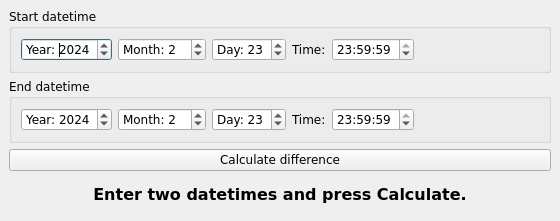
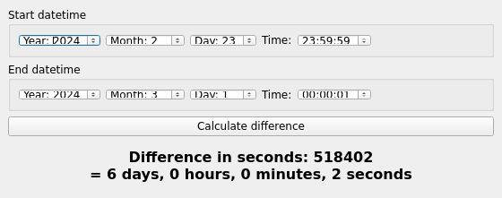

# DateTime Difference Calculator

A C++ program that calculates the difference in seconds between two datetime points, with proper handling of:
- Leap years
- Month/day transitions
- Time overflows (e.g., 23:59:59 + 2 seconds → 00:00:01 next day)

## Features
✅ Accurate second-level precision  
📅 Handles dates from year 1 onwards  
⏰ Supports 24-hour time format  
🔄 Automatic time/date overflow handling  
📈 Validates all datetime components  
🖥️ Cross-platform Qt GUI frontend

## Qt GUI Frontend

A desktop GUI built with **Qt Widgets (C++)** that wraps the same core calculation engine. No web browser required.

### Screenshots

Main window with the two datetime editors:



After pressing "Calculate difference" (2024-02-23 23:59:59 → 2024-03-01 00:00:01):



### Building the GUI (Linux / macOS / Windows)

Requirements: CMake 3.16+ and Qt 6 (Qt Widgets).

```bash
cd TimeCalculatorGui
cmake -S . -B build -DCMAKE_BUILD_TYPE=Release
cmake --build build -j
```

### Running the GUI

```bash
./build/TimeCalculatorGui
```

Pick a start and end datetime with the spin boxes and time pickers, then click
**Calculate difference**. The result is shown in seconds and broken down into
days / hours / minutes / seconds.

The GUI reuses the existing core logic (`Date.h`, `Time.h`, `DateTime.h`)
directly, so results are identical to the console version.

## Installation
1. Clone the repository:
```bash
git clone https://github.com/NoahIsARider/TimeCalculator.git
cd TimeCalculator
```

2. Compile with g++:
```bash
g++ TimeCalculator.cpp Time.cpp Date.cpp DateTime.cpp -o datetime_diff
```

## Usage
```bash
./datetime_diff
```

### Input Format
Enter two datetime values in this format when prompted:
```plaintext
yyyy,m,d,h,min,s
```
Example:
```plaintext
2024,2,23,23,59,59
2024,2,24,0,0,1
```

### Output
```plaintext
Difference in seconds: 2
```

## Test Cases
### Case 1: Same datetime
```plaintext
Input 1: 2024,2,23,10,30,30
Input 2: 2024,2,23,10,30,30
Output: Difference in seconds: 0
```

### Case 2: Cross midnight
```plaintext
Input 1: 2024,2,23,23,59,59
Input 2: 2024,2,24,0,0,0
Output: Difference in seconds: 1
```

### Case 3: Leap year transition
```plaintext
Input 1: 2020,2,28,23,59,59
Input 2: 2020,3,1,0,0,0
Output: Difference in seconds: 86401
```

## Implementation Details

### Class Structure
| Class      | Responsibility                              |
|------------|---------------------------------------------|
| `Time`     | Handles hour/minute/second logic            |
| `Date`     | Manages year/month/day calculations         |
| `DateTime` | Combines Date+Time with difference function |

### Key Methods
1. `Time::toSeconds()`  
   Converts time to total seconds (0-86399)

2. `Date::toDays()`  
   Calculates days since Jan 1, 0001 AD

3. `DateTime::diffSeconds()`  
   Core difference algorithm:
   ```cpp
   long long diff = (days1 - days2) * 86400 + (seconds1 - seconds2);
   ```

### Validation Logic
- **Month**: 1-12
- **Day**: Valid for current month/year
- **Hour**: 0-23
- **Minute/Second**: 0-59

## Contributing
1. Fork the repository
2. Create your feature branch:
```bash
git checkout -b feature/new-feature
```
3. Commit changes:
```bash
git commit -m 'Add some feature'
```
4. Push to branch:
```bash
git push origin feature/new-feature
```
5. Open a pull request

## License
MIT License © 2024 NoahIsARider
